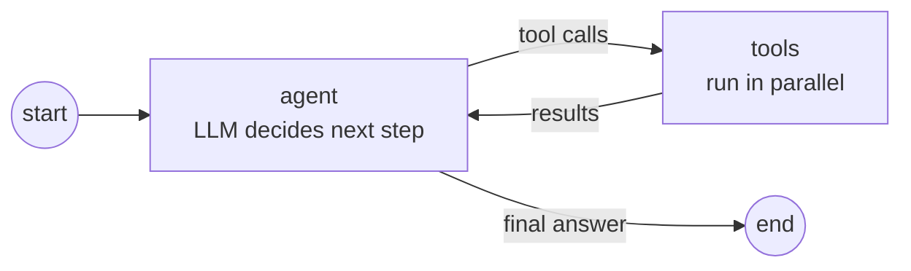

# Clause Deviation Agent

A single AI agent that compares an **Agreement for Sale** against a real-estate developer's
standard template, records every deviating clause with its severity and impact, and shows
its reasoning step by step.

Built with **LangGraph** (reason → act → observe loop), **native tool calling**,
**LangSmith** tracing and a **Streamlit** UI.

> **Live demo:** https://clause-deviation-agent.streamlit.app


## Why

I built a production version of this at work: a Claude Batch API pipeline that checked
1,400 sale agreements covering 465 flats against the standard template. This repo rebuilds
the idea as an open, single-agent LangGraph app on **fictional** agreements, so anyone can run it.

## How it works



Two tiers, because numbers and wording need different checks:

| Tier | Who | Catches |
|---|---|---|
| 1 | `compare_values` tool (regex, exact) | Changed amounts, percentages, durations, areas, dates; missing clauses |
| 2 | The LLM reading both clauses | Changed obligations, rights or venue when the numbers match (e.g. "shall pay" → "may, at its sole discretion, pay") |

Tools the agent can call:

| Tool | Purpose |
|---|---|
| `list_clauses(document_id)` | Clause keys and titles of the template or an agreement |
| `get_clause(document_id, clause_key)` | Full clause text, or a MISSING notice |
| `compare_values(agreement_id, clause_key)` | Exact tier-1 value diff; placeholder clauses (unit, price) may carry filled-in values |
| `record_finding(clause_key, severity, template_says, agreement_says, explanation)` | Structured output: one call per deviation |

## Sample agreements (fictional)

| Agreement | Planted deviations | Tier |
|---|---|---|
| A-101 | Grace period 6 → 12 months; maintenance advance 12 → 24 months | 1 |
| B-204 | Forfeiture 10% → 20%, refund 45 → 90 days; car-parking clause removed | 1 |
| B-204 | Arbitration seat Kolkata → Mumbai | 2 |
| C-307 | Payment schedule 10/40 → 20/30 | 1 |
| C-307 | Delay compensation "shall pay" → "may, at its sole discretion, pay" | 2 |

## Run it

```bash
pip install -r requirements.txt
streamlit run app.py
```

With no API key the app runs in **demo mode**: a rule-based stand-in drives the same graph
and tools and finds the tier-1 deviations only. For the live agent, set one of:

```bash
export ANTHROPIC_API_KEY=...   # optional: ANTHROPIC_MODEL (default claude-haiku-5-5)
export DEEPSEEK_API_KEY=...    # optional: DEEPSEEK_MODEL (default deepseek-chat)
export GROQ_API_KEY=...        # optional: GROQ_MODEL (default openai/gpt-oss-120b)
```

If several keys are set, the first in the order Claude → DeepSeek → Groq is used and the rest are automatic fallbacks. Model IDs change over time; set `ANTHROPIC_MODEL` / `DEEPSEEK_MODEL` / `GROQ_MODEL` to a current one if the default is retired.

### Tracing with LangSmith

```bash
export LANGSMITH_TRACING=true
export LANGSMITH_API_KEY=...
export LANGSMITH_PROJECT=clause-deviation-agent
```

Every run then appears in LangSmith with each model call and tool call.

## Deploy (Streamlit Community Cloud)

1. Fork or use this repo, then create an app at share.streamlit.io with `app.py` as the entry point.
2. In **Settings → Secrets**, add `ANTHROPIC_API_KEY = "..."` (or `DEEPSEEK_API_KEY` / `GROQ_API_KEY`), and optionally the LangSmith keys.

## Tests

```bash
pytest
```

The tests cover clause parsing, value extraction and full graph runs driven by the
scripted model, so they need no API key. CI runs lint and tests on every push.

## Project layout

```
agent/
  documents.py   # Markdown -> clauses
  values.py      # tier-1 value extraction and diff
  tools.py       # the four tools
  graph.py       # LangGraph StateGraph + system prompt
  llm.py         # Claude / DeepSeek / Groq / demo model selection
  demo_model.py  # rule-based stand-in for keyless demo
data/            # fictional template and agreements
app.py           # Streamlit UI
tests/
```

## Author

**Pallav Kumar**, AI Automation Engineer · [LinkedIn](https://www.linkedin.com/in/pallav-kumar-ai)

All names, projects and agreements in this repository are fictional.
