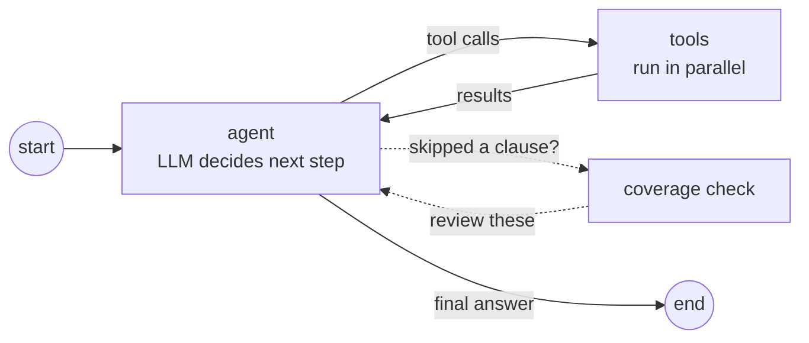

# Clause Deviation Agent

A single AI agent that compares an **Agreement for Sale** against a real-estate developer's
standard template, records every deviating clause with its severity and impact, and shows
its reasoning step by step. A **Chat** tab lets you ask about the documents in plain words
("What changed in B-204's cancellation clause?", "Compare the possession clause in A-101 and B-204").

An **Evidence** tab uses Google's **LangExtract** to pull the key terms from both documents and
pin each one to its exact character span, so every difference is highlighted in the source text.

Built with **LangGraph** (reason → act → observe loop), **native tool calling**, **LangExtract**
(source-grounded extraction), **LangSmith** tracing and a **Streamlit** UI.

> **Live demo:** https://clause-deviation-agent.streamlit.app


## Why

I built a production version of this at work: a Claude Batch API pipeline that checked
1,400 sale agreements covering 465 flats against the standard template. This repo rebuilds
the idea as an open, single-agent LangGraph app on **fictional** agreements, so anyone can run it.

## How it works



The **coverage check** is plain code, not the LLM: when the agent tries to finish, the graph compares
the clauses it actually reviewed with the template. If any were skipped, it sends the agent back with
the list (at most twice). The results page shows "Clauses reviewed: N / 11", so a partial review is visible.

Two tiers, because numbers and wording need different checks:

| Tier | Who | Catches |
|---|---|---|
| 1 | Value check inside `review_clause` (regex, exact) | Changed amounts, percentages, durations, areas, dates; missing clauses |
| 2 | The LLM reading both clauses | Changed obligations, rights or venue when the numbers match (e.g. "shall pay" → "may, at its sole discretion, pay") |

Tools the agent can call:

| Tool | Purpose |
|---|---|
| `list_clauses(document_id)` | Clause keys and titles of the template or an agreement |
| `review_clause(agreement_id, clause_key)` | Template text, agreement text (or a MISSING notice) and the exact tier-1 value diff in one call; placeholder clauses (unit, price) may carry filled-in values |
| `record_finding(clause_key, severity, template_says, agreement_says, explanation)` | Structured output: one call per deviation (review only) |
| `list_agreements()` | IDs of the stored agreements, including pasted ones (chat only) |

Chat mode uses the same loop with the read-only tools and a prompt that answers only from the documents.

### Evidence: source-grounded key terms (LangExtract)

A finding is only useful if a reviewer can see where it came from. The Evidence tab runs
[LangExtract](https://github.com/google/langextract) over the template and the agreement with a
few-shot prompt for nine key terms: payment milestones, possession date, grace period, delay
compensation (amount and whether it is *mandatory* or *discretionary*), maintenance advance,
forfeiture, refund period, car parking and arbitration seat.

- Each term comes back with its **character offsets** in the source. LangExtract aligns the
  quoted text to the document, so a quote the model invented has no span and is visible as ungrounded.
- Terms are matched (milestones by stage) and compared, then highlighted side by side:
  same, changed, missing or extra.
- "Quotes matching source exactly" = share of terms where `text[start:end]` equals the quote.

LangExtract calls the same model chain as the agent through a small provider wrapper
(`LangChainExtractor`), so Claude, Gemini, DeepSeek and Groq all work. With no key, a rule-based
provider answers LangExtract's prompt in the same JSON format, so chunking, parsing and alignment
still run end to end.

Score it against the planted deviations:

```bash
python scripts/eval_grounding.py          # configured live model, or demo provider with no key
python scripts/eval_grounding.py --demo   # rule-based provider
```

Demo provider result: all 9 planted deviations found, 0 false flags (precision 9/9, recall 9/9),
and 100% of quotes reproduce their source span. Live-model numbers depend on the model; run the
script to measure them.

## Sample agreements (fictional)

| Agreement | Planted deviations | Tier |
|---|---|---|
| A-101 | Grace period 6 → 12 months; maintenance advance 12 → 24 months | 1 |
| B-204 | Forfeiture 10% → 20%, refund 45 → 90 days; car-parking clause removed | 1 |
| B-204 | Arbitration seat Kolkata → Mumbai | 2 |
| C-307 | Payment schedule 10/40 → 20/30 | 1 |
| C-307 | Delay compensation "shall pay" → "may, at its sole discretion, pay" | 2 |

## Run it

```bash
pip install -r requirements.txt
streamlit run app.py
```

With no API key the app runs in **demo mode**: a rule-based stand-in drives the same graph
and tools and finds the tier-1 deviations only. For the live agent, set one of:

```bash
export ANTHROPIC_API_KEY=...   # optional: ANTHROPIC_MODEL (default claude-haiku-5-5)
export GEMINI_API_KEY=...      # optional: GEMINI_MODEL (default gemini-3.5-flash-lite)
export DEEPSEEK_API_KEY=...    # optional: DEEPSEEK_MODEL (default deepseek-chat)
export GROQ_API_KEY=...        # optional: GROQ_MODEL (default openai/gpt-oss-120b)
```

If several keys are set, the first in the order Claude → Gemini → DeepSeek → Groq is used and the rest are automatic fallbacks (on a rejected key, an empty balance or a rate limit). Set `MODEL_ORDER`, e.g. `gemini,groq`, to change the order or leave providers out. Model IDs change over time; set `ANTHROPIC_MODEL` / `GEMINI_MODEL` / `DEEPSEEK_MODEL` / `GROQ_MODEL` to a current one if the default is retired. Gemini and Groq both have free tiers.

### Tracing with LangSmith

```bash
export LANGSMITH_TRACING=true
export LANGSMITH_API_KEY=...
export LANGSMITH_PROJECT=clause-deviation-agent
```

Every run then appears in LangSmith with each model call and tool call.

## Deploy (Streamlit Community Cloud)

1. Fork or use this repo, then create an app at share.streamlit.io with `app.py` as the entry point.
2. In **Settings → Secrets**, add `ANTHROPIC_API_KEY = "..."` (or `GEMINI_API_KEY` / `DEEPSEEK_API_KEY` / `GROQ_API_KEY`), and optionally the LangSmith keys.

## Tests

```bash
pytest
```

The tests cover clause parsing, value extraction, full graph runs driven by the
scripted model, and LangExtract grounding (every span matches its quote; the diff flags exactly
the planted deviations), so they need no API key. CI runs lint and tests on every push.

## Project layout

```
agent/
  documents.py   # Markdown -> clauses
  values.py      # tier-1 value extraction and diff
  grounding.py   # LangExtract key-term extraction, source spans, diff, highlighting
  tools.py       # the four tools
  graph.py       # LangGraph StateGraph + system prompt
  llm.py         # Claude / DeepSeek / Groq / demo model selection
  demo_model.py  # rule-based stand-in for keyless demo
data/            # fictional template and agreements
scripts/
  eval_grounding.py  # precision / recall / grounding rate vs planted deviations
app.py           # Streamlit UI
tests/
```

## Author

**Pallav Kumar**, AI Automation Engineer · [LinkedIn](https://www.linkedin.com/in/pallav-kumar-ai)

All names, projects and agreements in this repository are fictional.
